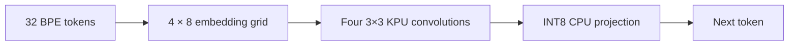
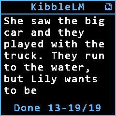

# KibbleLM

KibbleLM is a **314K-parameter convolutional language model** for English story continuation on the Kendryte K210. It predicts the next subword from a 32-token window. Its four-layer backbone compiles to KModel v4 and runs on the K210 KPU.

[Download the model package](https://github.com/aztechell/kibble-lm/releases/download/v0.1.0/kibblelm-sd-v0.1.0.zip) · [Model card](docs/model-card.md) · [Train and export](docs/training.md)

## Architecture

The [PyTorch model](model.py) maps the tokens to 32-channel embeddings and reads the output at one grid position. A CPU projection scores the 2,048-token vocabulary from that position's 64 features. The export contains a **116.5 KiB** KModel backbone and a companion file for the tokenizer, embeddings, and INT8 projection. Together they take **374 KiB**.

## Training and quality

The model was trained from scratch on 100,000 TinyStories. Perplexity is measured on the same 4,096 held-out targets for all three variants.

| Model | Perplexity ↓ |
| --- | ---: |
| FP32 CNN | 48.71 |
| KModel backbone + INT8 CPU projection | 53.39 |
| Smoothed bigram baseline | 64.18 |

The [training guide](docs/training.md) covers data preparation, FP32 training, KPU calibration, and distillation of the CPU projection. It also shows how to verify the compiled graph with the nncase simulator on a PC.

On a shared 256-story slice, KibbleLM FP32 scored **1.277 bits/byte**, compared with **1.011** for stories260K and **1.016** for MicroMixer-4-300K. [Peer comparison, samples, and reproduction](docs/peer-comparison.md)

## Hardware demo

The same 374 KiB model package ran on two K210 boards. Both measurements include LCD updates.

| Board | Tokens/s | Time to first token |
| --- | ---: | ---: |
| HUSKYLENS SEN0305 | 13.19 | 60.0–62.7 ms |
| Sipeed Maix Cube | 15.45–15.48 | 52.6–52.8 ms |

 

[Benchmark builds](docs/model-card.md#hardware-measurements) · [SEN0305 release](docs/firmware.md#flash-the-release) · [Maix Cube build](docs/firmware.md#build-for-maix-cube)

KibbleLM source code is available under the [MIT License](LICENSE).
