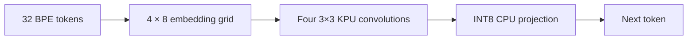
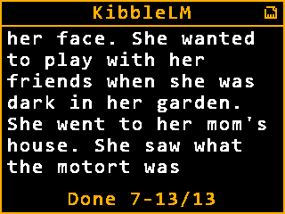

# KibbleLM

KibbleLM is a **446K-parameter convolutional language model** for English story continuation on the Kendryte K210. It predicts the next subword from a 32-token window. Its four-layer backbone compiles to KModel v4 and runs on the K210 KPU.

[Download the K210 model](https://github.com/aztechell/kibble-lm/releases/download/v0.2.0/kibblelm-sd-v0.2.0.zip) · [Download FP32 weights](https://github.com/aztechell/kibble-lm/releases/download/v0.2.0/kibblelm-fp32-v0.2.0.zip) · [Model card](docs/model-card.md) · [Train and export](docs/training.md)

## Architecture

The [PyTorch model](model.py) maps the tokens to 32-channel embeddings and reads 76 features at one grid position. A CPU projection scores the 2,048-token vocabulary. The export contains a **222 KiB** KModel backbone and a companion file for the tokenizer, embeddings, and INT8 projection. Together they take **503 KiB**.

## Training and quality

The v0.2 model was trained on **1.80 million unique TinyStories** with a Transformer teacher and quantization-aware fine-tuning. Perplexity is measured on the same 4,096 validation targets.

| Model | Perplexity ↓ |
| --- | ---: |
| v0.2 FP32 | 32.29 |
| **v0.2 KModel + INT8 CPU projection** | **32.47** |
| v0.1 KModel + INT8 CPU projection | 53.39 |
| Smoothed bigram on the v0.2 corpus | 62.16 |

The [training guide](docs/training.md) covers data preparation, FP32 training, KPU calibration, and distillation of the CPU projection. It also shows how to verify the compiled graph with the nncase simulator on a PC.

On a shared 256-story slice, KibbleLM FP32 improved from **1.277** to **1.135 bits/byte**. The same test gave **1.011** for stories260K and **1.016** for MicroMixer-4-300K. [Peer comparison, samples, and reproduction](docs/peer-comparison.md)

## Hardware demo

The same 503 KiB model package ran on two K210 boards. Both measurements include LCD updates.

| Board | Tokens/s | Time to first token |
| --- | ---: | ---: |
| HUSKYLENS SEN0305 | 13.02–13.40 | 62.6–65.2 ms |
| Sipeed Maix Cube | 15.27–15.80 | 53.8–54.0 ms |

 

[Benchmark builds](docs/model-card.md#hardware-measurements) · [Run on either board](docs/firmware.md#flash-the-release)

KibbleLM source code is available under the [MIT License](LICENSE).
